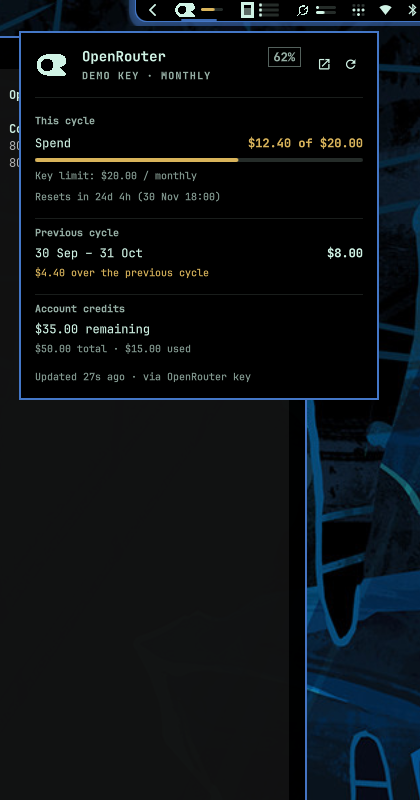

# OpenRouter Usage

An Omarchy bar widget for the OpenRouter API key already used by OpenCode. It
shows the key's current cycle spend against its own limit, or just the spend
when the key has no limit, and keeps one previous completed cycle locally for
comparison.


There is no subscription. The widget asks OpenRouter for the key's own budget:

```bash
curl https://openrouter.ai/api/v1/key -H "Authorization: Bearer $OPENROUTER_API_KEY"
```

The key is read from `OPENROUTER_API_KEY`, or from the `openrouter` entry in
`~/.local/share/opencode/auth.json`. It is never written to the plugin cache,
printed, or passed on a command line.



## What it shows

In the bar:

- the official OpenRouter mark
- a meter of **current cycle spend / key limit**
- **just the spend** when the key has no limit, or when the current cycle is
  over the previous completed cycle
- colours: slightly yellow when over the previous cycle, orange at 90% of the
  limit, red at the limit

In the popup:

- **This cycle** spend, key limit, reset countdown and clock
- **Previous cycle** spend and the difference from the current cycle
- **Account credits** when OpenRouter reports them
- the masked key label and limit interval

## Cycle history

OpenRouter exposes the key's current cycle, but not its past cycles (the
activity endpoint requires a management key). The widget keeps exactly one
current and one previous cycle in its cache:

```json
{
  "version": 1,
  "fetchedAt": 0,
  "data": { "limit": 20, "spend": 0, "cycle": {} },
  "history": {
    "current": { "key": "monthly:...", "spend": 0 },
    "previous": { "key": "monthly:...", "spend": 12.4 }
  }
}
```

Only two cycle records are retained; there is no growing history array. A
previous cycle is used only if the widget observed it close to its reset, so a
partial/missed cycle does not become a misleading baseline.

When a key has **no limit**, the widget shows spend only until a completed
cycle exists. After that, the previous cycle's spend becomes the effective
limit and a bar appears. If the current cycle goes over that previous spend,
the widget switches back to a dollar amount and the text turns yellow.

## Colour precedence

1. **Red** — reached the key limit (or, with no key limit, reached the previous
   cycle's spend).
2. **Orange** — at least 90% of the effective limit.
3. **Yellow** — over the previous completed cycle (but not yet at 90%/limit).

## Install

```bash
git clone https://github.com/crueber/omarchy-plugin-openrouter-usage.git
cd omarchy-plugin-openrouter-usage
./scripts/install.sh
```

The installer copies the runtime files to
`~/.config/omarchy/plugins/crueber.openrouter-usage/`, validates the manifest,
and enables the widget in the right bar section. Pass another section as the
first argument.

To remove:

```bash
omarchy plugin disable crueber.openrouter-usage
omarchy plugin remove crueber.openrouter-usage --yes
rm -rf ~/.cache/openrouter-usage
```

## Use

- **Left click** — open or close the popup
- **Middle click** — refresh now
- **Right click** — open the OpenRouter activity page (or `onRightClick`)
- **`r`** — refresh while the popup is open

## Privacy

- The key is read at request time from `OPENROUTER_API_KEY` or the existing
  OpenCode auth file; it is not cached, logged, or placed in `shell.json`.
- The only network requests are `GET /api/v1/key` and, when available,
  `GET /api/v1/credits` on `openrouter.ai`.
- The cache contains only the displayed numbers, the masked key label, the
  current/previous cycle records, and the last error. It lives in a mode-`0700`
  directory (`~/.cache/openrouter-usage`).

## Settings

| Key | Default | Meaning |
| --- | --- | --- |
| `refreshIntervalSec` | `300` | Refresh interval (60–3600) |
| `nodeCommand` | `""` | Optional path to `node` |
| `authFile` | `""` | Optional OpenCode auth file; empty uses `~/.local/share/opencode/auth.json` |
| `showCredits` | `true` | Show account credits in the popup |
| `compareColor` | `#d9b45b` | Yellow when over the previous cycle |
| `warningColor` | `#f67400` | Orange at 90% |
| `criticalColor` | `""` | Red at the limit; empty uses the theme urgent colour |
| `onRightClick` | `""` | Optional shell command |

## Requirements

- Omarchy with the Omarchy shell bar
- Node.js for the small OpenRouter helper
- An OpenRouter API key in `OPENROUTER_API_KEY` or the OpenCode `openrouter`
  credential

## Licence

MIT
